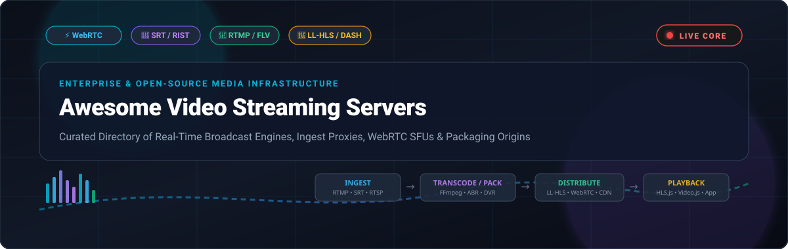

<div align="center">



# 🎥 Awesome Video Streaming Servers

<p align="center">
  <a href="https://github.com/ishandutta2007/Awesome-Awesome-Awesome"></a><a href="https://discord.gg/jc4xtF58Ve"></a>
  <a href="LICENSE"></a>
  <a href="https://github.com/ishandutta2007/Awesome-Video-Streaming-Servers/pulls"></a>
  <a href="https://github.com/ishandutta2007/Awesome-Video-Streaming-Servers/stargazers"></a>
  <a href="https://github.com/ishandutta2007/Awesome-Video-Streaming-Servers/issues"></a>
  <a href="https://github.com/ishandutta2007"></a>
</p>

<p align="center">
  <strong>Curated directory of production-grade live video streaming servers, broadcast origins, real-time WebRTC SFUs, RTMP/SRT ingest proxies, low-latency packaging engines, and enterprise media cloud SaaS platforms.</strong>
</p>

</div>

---

## 📑 Table of Contents

- [🌐 Architecture & Protocol Matrix](#-architecture--protocol-matrix)
- [📊 Sector Overview & Market Dynamics](#-sector-overview--market-dynamics)
- [☁️ Top SaaS & Hosted Streaming Platforms](#️-top-saas--hosted-streaming-platforms)
- [🚀 Top Open-Source Streaming Servers](#-top-open-source-streaming-servers)
  - [⭐ Open-Source Ranking Table](#-open-source-ranking-table)
  - [🔍 Deep Dive: Live Media Servers & SFUs](#-deep-dive-live-media-servers--sfus)
  - [🧰 Deep Dive: Video Transcoding & Tooling](#-deep-dive-video-transcoding--tooling)
- [🏗️ Recommended Production Stacks](#️-recommended-production-stacks)
- [🤝 How to Contribute](#-how-to-contribute)
- [⭐ Star History](#-star-history)
- [💖 Support & Community](#-support--community)
- [⚖️ Disclaimer & License](#️-disclaimer--license)

---

## 🌐 Architecture & Protocol Matrix

A modern **video streaming server** handles live ingest, audio/video transrating, ABR (Adaptive Bitrate) packaging, and sub-second or edge distribution. Below is how leading live media protocols compare:

```
[ Broadcaster: OBS / Camera / Phone ]
                 │
                 ▼ Ingest (RTMP / SRT / RTSP / WHIP)
┌────────────────────────────────────────────────────────┐
│             Video Streaming Media Server               │
│  ├── Ingest Proxy & Demuxing                           │
│  ├── ABR Ladder Transcoding (FFmpeg / Hardware NVENC)  │
│  └── Live Packaging (LL-HLS, DASH, WebRTC, HTTP-FLV)   │
└────────────────────────────────────────────────────────┘
                 │
                 ▼ Egress (WHEP / HLS / DASH / WebSockets)
[ Global CDN / Edge Distribution ] ──▶ [ Web / Mobile / SmartTV Players ]
```

| Protocol | Typical Latency | Transport | Primary Use Case | Standard Ingest / Egress |
| :--- | :--- | :--- | :--- | :--- |
| **WebRTC (WHIP/WHEP)** | `< 500 ms` (Sub-second) | UDP (DTLS/SRTP) | Ultra-low latency interactive, auctions, gaming, webinars | Bi-directional |
| **SRT (Secure Reliable Transport)** | `500 ms – 1.5 s` | UDP (ARQ + Encryption) | Unreliable long-haul public internet broadcast ingest | Primarily Ingest |
| **RTMP / RTMPS** | `1.0 – 3.0 s` | TCP | Universal broadcast ingest from OBS, hardware encoders | Ingest Standard |
| **LL-HLS (Low-Latency HLS)** | `1.5 – 3.0 s` | HTTP/2 or HTTP/3 | Scalable low-latency broadcast to massive Apple & web audiences | Egress to CDN |
| **DASH / LL-DASH** | `2.0 – 4.0 s` | HTTP/TCP | Open international standard ABR streaming for multi-device delivery | Egress to CDN |
| **RTSP** | `500 ms – 1.5 s` | UDP / TCP | CCTV, IP security cameras, surveillance feeds | Ingest & Local Relay |

---

## 📊 Sector Overview & Market Dynamics

The global video streaming infrastructure and media server market was valued at **$10.5 billion in 2024** and is projected to reach **$32.8 billion by 2032**, expanding at a compound annual growth rate (**CAGR of ~15.2%**), propelled by skyrocketing demand for interactive live commerce, AI-generated synthetic video streams, remote real-time telepresence, and sub-second sports broadcasting.

The market structure is **moderately fragmented**: hyperscale cloud giants (*AWS Elemental, Cloudflare*) dominate elastic multi-region CDN distribution and serverless transcoding pipelines, while specialized media server vendors (*Wowza, Flussonic, Red5 Pro*) and a resilient, vibrant open-source ecosystem (*MediaMTX, SRS, ZLMediaKit, LiveKit*) maintain significant dominance for private on-premises origin ingest, sovereignty-compliant edge clusters, and cost-controlled high-throughput streaming environments.

---

## ☁️ Top SaaS & Hosted Streaming Platforms

The following hosted platforms provide managed ingest, real-time encoding, broadcast packaging, and global CDN delivery without requiring manual infrastructure provisioning.

> **Sorted by Company Size / Valuation / Revenue (Descending)**

| Platform | Company Size / Valuation / Revenue | Specific Starting Pricing | Specific Free Tier / Free Trial Limits | Key Capabilities & Protocols |
| :--- | :--- | :--- | :--- | :--- |
| **[AWS Elemental MediaLive](https://aws.amazon.com/medialive/)** | **~$2.10 Trillion** Market Cap<br>*(~$575B Revenue)* | **$0.0456/hour** *(AVC HD 1080p, Single Pipeline, US East) + $0.008/hr ingest* | **30-Day Free Trial** with **$300 promotional AWS credits** for new accounts *(plus 12-Month Free Tier: 750 hrs/mo EC2 for self-hosting)* | Cloud broadcast encoding, multi-pipeline high availability, RTMP/SRT/Zixi ingest, MediaPackage HLS/DASH packaging. |
| **[Cloudflare Stream](https://www.cloudflare.com/products/cloudflare-stream/)** | **~$32.0 Billion** Market Cap<br>*(~$1.5B Revenue)* | **$5.00/month** *(includes 1,000 min video stored; $1.00 per 1,000 min streamed)* | **Free WebRTC Tier** on Cloudflare Calls *(1,000 free live minutes/month forever)*; Stream starting base is $5/mo with no auto-expiration. | Direct global Anycast network delivery, sub-second WebRTC (WHEP), automatic ABR ladder generation, integrated HTML5 player. |
| **[Mux Video](https://www.mux.com/)** | **~$1.50 Billion** Valuation<br>*(~$100M+ ARR, Private)* | **$0.005/minute** live encoding + **$0.003/min** storage/mo + **$0.0013/min** delivery | **$100 Free Usage Credit** upon registration *(no expiration, covers ~20,000 live streaming minutes)* | Developer-first API, instant live-to-VOD clipping, low-latency HLS, real-time QoS analytics and video health monitoring. |
| **[Vimeo Enterprise & Live](https://vimeo.com/)** | **~$1.10 Billion** Market Cap<br>*(~$415M Revenue)* | **$12.00/month** *(Starter, billed annually)* or **$65.00/month** *(Advanced with live streaming)* | **Free Forever Plan** *(3 videos total, 500 MB/week upload, 1 GB total storage)*; or **30-Day Free Trial** on paid live plans. | Turnkey creator and enterprise broadcasting, RTMP live ingest, multi-destination simulcasting, integrated chat and Q&A. |
| **[Agora Real-Time Streaming](https://www.agora.io/)** | **~$350 Million** Market Cap<br>*(~$140M Revenue)* | **$0.99 per 1,000 minutes** *(Standard HD 720p Real-Time Live Video)* | **10,000 Free Minutes Every Month** forever across all audio and video streaming APIs. | Proprietary Software-Defined Real-time Network (SD-RTN), sub-400ms ultra-low latency, interactive co-hosting SDKs. |
| **[Wowza Video](https://www.wowza.com/)** | **~$200 Million** Valuation<br>*(~$60M ARR, Clearhaven)* | **$25.00/month** *(Pay-As-You-Go + $0.30/hr processing & $0.10/GB data)* or **$149.00/month** | **30-Day Free Trial** with **48 streaming hours** and **100 GB bandwidth limit**. | Enterprise gold-standard media engine, multi-protocol transcoding, WebRTC, SRT, RTMP, HLS/DASH, and DRM encryption. |
| **[Flussonic Cloud](https://flussonic.com/)** | **~$25 Million** Valuation<br>*(~$15M ARR, Private)* | **$199.00/month** per server license *(unlimited streams up to hardware bandwidth)* | **14-Day Full-Featured Free Trial** *(1 server license with full DVR, mosaic, and WebRTC capability)*. | High-throughput carrier-grade media server, satellite DVB ingest, DVR archive recording, GPU hardware acceleration. |
| **[Dacast](https://www.dacast.com/)** | **~$20 Million** Valuation<br>*(~$10M Revenue, Private)* | **$39.00/month** *(Starter plan, billed annually; includes 2.4 TB bandwidth/yr & 500 GB storage)* | **14-Day Free Trial** with **10 GB bandwidth** and **20 GB storage limit**. | B2B video platform with live paywall, white-label video player, Akamai CDN integration, China video delivery. |
| **[Ant Media Server Enterprise](https://antmedia.io/)** | **~$15 Million** Valuation<br>*(~$5M Revenue, Private)* | **$0.29/hour** on AWS/Azure, or **$99.00/month** per self-hosted enterprise license | **Community Edition is 100% Free Forever**; Enterprise has **30-Day Free Trial** with full WebRTC clustering. | Sub-0.5s WebRTC streaming, adaptive auto-scaling clusters, CMAF low-latency packaging, RTMP/SRT/RTSP gateways. |
| **[Red5 Pro Cloud](https://www.red5pro.com/)** | **~$10 Million** Valuation<br>*(~$4M Revenue, Private)* | **$29.99/server/month** *(up to 100 concurrent streams)* or **$120.00/server/month** *(unlimited)* | **30-Day Free Trial** with **1 server license** and **up to 100 concurrent connections**. | Ultra-low latency WebRTC streaming at scale, cross-cloud auto-scaling controller, WebRTC/RTSP/RTMP real-time relays. |

---

## 🚀 Top Open-Source Streaming Servers

The open-source ecosystem provides battle-tested engines that allow complete sovereignty over media pipelines, zero vendor lock-in, and negligible marginal cost at scale.

### ⭐ Open-Source Ranking Table

> **Sorted by Stars_Counts (Descending)**. Every badge links directly to the repository's stargazers page.

| Repository | GitHub_Stars_Badge | Primary Language | Ingest Protocols | Egress Protocols | Best Used For |
| :--- | :---: | :---: | :--- | :--- | :--- |
| **[OBS Studio](https://github.com/obsproject/obs-studio)** | [](https://github.com/obsproject/obs-studio/stargazers) | C / C++ | Screen, Mic, SDI, NDI | RTMP, SRT, WHIP, RIST | Universal desktop live production, screen capture & encoder |
| **[FFmpeg](https://github.com/FFmpeg/FFmpeg)** | [](https://github.com/FFmpeg/FFmpeg/stargazers) | C | All known formats | All known formats | Universal audio/video transcoding, muxing & packaging engine |
| **[Jellyfin](https://github.com/jellyfin/jellyfin)** | [](https://github.com/jellyfin/jellyfin/stargazers) | C# | VOD files, Live TV Tuners | HLS, DASH, Direct Play | Self-hosted media streaming system & 100% free Plex alternative |
| **[SRS (Simple Realtime Server)](https://github.com/ossrs/srs)** | [](https://github.com/ossrs/srs/stargazers) | C++ | RTMP, SRT, WebRTC, RTSP | WebRTC, HLS, HTTP-FLV, SRT | High-scale, clustered real-time video origin and relay |
| **[LiveKit](https://github.com/livekit/livekit)** | [](https://github.com/livekit/livekit/stargazers) | Go | WebRTC, WHIP, SIP | WebRTC, WHEP, HLS, Egress | Real-time multi-modal AI agents, audio/video conferencing & SFU |
| **[MediaMTX](https://github.com/bluenviron/mediamtx)** | [](https://github.com/bluenviron/mediamtx/stargazers) | Go | SRT, WebRTC, RTSP, RTMP | WebRTC, HLS, RTSP, RTMP | Zero-dependency multi-protocol streaming proxy and edge origin |
| **[ZLMediaKit](https://github.com/ZLMediaKit/ZLMediaKit)** | [](https://github.com/ZLMediaKit/ZLMediaKit/stargazers) | C++ | RTSP, RTMP, WebRTC, SRT | WebRTC, RTSP, RTMP, HLS, FLV | High-performance C++20 media service for IP surveillance & live |
| **[Pion WebRTC](https://github.com/pion/webrtc)** | [](https://github.com/pion/webrtc/stargazers) | Go | Pure Go WebRTC API | Pure Go WebRTC API | Building bespoke WebRTC servers, proxies, and SFU gateways |
| **[PeerTube](https://github.com/Chocobozzz/PeerTube)** | [](https://github.com/Chocobozzz/PeerTube/stargazers) | TypeScript | RTMP, Web Video Uploads | HLS + P2P WebTorrent | Decentralized, federated ActivityPub video hosting platform |
| **[go2rtc](https://github.com/AlexxIT/go2rtc)** | [](https://github.com/AlexxIT/go2rtc/stargazers) | Go | RTSP, WebRTC, HomeKit, RTMP | WebRTC, MSE, HLS, RTSP | Ultimate smart home camera streaming application (Home Assistant) |
| **[nginx-rtmp-module](https://github.com/arut/nginx-rtmp-module)** | [](https://github.com/arut/nginx-rtmp-module/stargazers) | C | RTMP | RTMP, HLS, MPEG-DASH | Classic NGINX module for simple RTMP relay and HLS generation |
| **[Owncast](https://github.com/owncast/owncast)** | [](https://github.com/owncast/owncast/stargazers) | Go | RTMP, OBS Studio | LL-HLS + Built-in Chat | Self-hosted, independent alternative to Twitch and YouTube Live |
| **[Janus Gateway](https://github.com/meetecho/janus-gateway)** | [](https://github.com/meetecho/janus-gateway/stargazers) | C | WebRTC, RTP/RTCP | WebRTC | Modular C-based WebRTC Selective Forwarding Unit (SFU) gateway |
| **[Node-Media-Server](https://github.com/illuspas/Node-Media-Server)** | [](https://github.com/illuspas/Node-Media-Server/stargazers) | JavaScript | RTMP, RTSP | HTTP-FLV, WebSocket-FLV, HLS | Lightweight Node.js streaming server for quick JavaScript integration |
| **[Restreamer](https://github.com/datarhei/restreamer)** | [](https://github.com/datarhei/restreamer/stargazers) | Go / Vue | RTMP, SRT, RTSP, HLS | YouTube, Twitch, HLS, WHEP | Turnkey Docker streaming GUI with multi-platform restreaming |
| **[Ant Media Server](https://github.com/ant-media/Ant-Media-Server)** | [](https://github.com/ant-media/Ant-Media-Server/stargazers) | Java | RTMP, RTSP, WebRTC, SRT | WebRTC, CMAF, HLS, RTMP | Ultra-low latency streaming engine with WebRTC data channels |
| **[Red5 Server](https://github.com/Red5/red5-server)** | [](https://github.com/Red5/red5-server/stargazers) | Java | RTMP, RTSP | RTMP, HLS, WebSockets | Open-source Java media server core powering real-time apps |
| **[OvenMediaEngine](https://github.com/OvenMediaLabs/OvenMediaEngine)** | [](https://github.com/OvenMediaLabs/OvenMediaEngine/stargazers) | C++ | RTMP, SRT, RTSP, WebRTC | Sub-second WebRTC, Low-Latency HLS | Sub-second latency streaming server with built-in WebRTC player |
| **[MistServer](https://github.com/DDVTECH/mistserver)** | [](https://github.com/DDVTECH/mistserver/stargazers) | C++ | RTMP, RTSP, TS, SRT | HLS, DASH, WebRTC, FLV | Lightweight, multi-format modular streaming server for OTT |

---

### 🔍 Deep Dive: Live Media Servers & SFUs

#### 1. [SRS (Simple Realtime Server)](https://github.com/ossrs/srs) [](https://github.com/ossrs/srs/stargazers)
- **Architecture**: Single-threaded asynchronous state machine with coroutines (State-Threads), written in modern C++.
- **Strengths**: Extreme scalability under high-concurrency loads. Seamless protocol conversion between RTMP, WebRTC, SRT, and HTTP-FLV. Integrates deeply with Kubernetes clusters and Prometheus metrics.
- **Ideal For**: Large enterprise live streaming architectures, live shopping, and high-concurrency broadcast backbones.

#### 2. [LiveKit](https://github.com/livekit/livekit) [](https://github.com/livekit/livekit/stargazers)
- **Architecture**: Distributed WebRTC SFU built in Go with Redis-backed clustering and automated room routing.
- **Strengths**: The premier developer platform for real-time interactive audio/video, spatial audio, telephony (SIP), and real-time multimodal Voice AI agents.
- **Ideal For**: Interactive conferencing, real-time AI companions, telehealth, and collaborative apps.

#### 3. [MediaMTX](https://github.com/bluenviron/mediamtx) [](https://github.com/bluenviron/mediamtx/stargazers)
- **Architecture**: Standalone Go binary with zero external dependencies, formerly known as *rtsp-simple-server*.
- **Strengths**: Ingests and converts RTSP, RTMP, WebRTC (WHIP/WHEP), SRT, and Media-over-QUIC simultaneously. Hot configuration reload without dropping client connections.
- **Ideal For**: IoT edge gateways, drone streaming, security camera forwarding, and lightweight multi-protocol origins.

#### 4. [ZLMediaKit](https://github.com/ZLMediaKit/ZLMediaKit) [](https://github.com/ZLMediaKit/ZLMediaKit/stargazers)
- **Architecture**: High-concurrency C++20 network framework with event-driven epoll/kqueue.
- **Strengths**: Unmatched hardware throughput, multi-thread processing, full support for GB28181 (surveillance standard), RTSP, WebRTC, and MP4 recording.
- **Ideal For**: Smart city camera matrices, industrial video processing, and high-density surveillance ingest.

#### 5. [Owncast](https://github.com/owncast/owncast) [](https://github.com/owncast/owncast/stargazers)
- **Architecture**: Self-contained Go application with embedded web UI, chat engine, and FFmpeg transcoding manager.
- **Strengths**: Single-binary deployment, built-in interactive chat with emoji reactions, webhook automations, ActivityPub federation, and zero tracking.
- **Ideal For**: Content creators, privacy-focused educators, gaming streamers, and digital sovereignty.

#### 6. [OvenMediaEngine (OME)](https://github.com/OvenMediaLabs/OvenMediaEngine) [](https://github.com/OvenMediaLabs/OvenMediaEngine/stargazers)
- **Architecture**: High-performance C++ sub-second streaming engine supporting WebRTC and Low Latency HLS (LL-HLS) alongside OvenPlayer.
- **Strengths**: True sub-second latency from capture to screen across global audiences with automatic fallback to LL-HLS.
- **Ideal For**: Live auctions, e-sports betting, interactive quiz shows, and ultra-fast broadcast delivery.

---

### 🧰 Deep Dive: Video Transcoding & Tooling

- **[OBS Studio](https://github.com/obsproject/obs-studio) [](https://github.com/obsproject/obs-studio/stargazers)**: The industry standard open-source desktop studio for scene composition, multi-camera switching, audio mixing, and broadcast encoding via RTMP, SRT, and WHIP.
- **[FFmpeg](https://github.com/FFmpeg/FFmpeg) [](https://github.com/FFmpeg/FFmpeg/stargazers)**: The universal media powerhouse. Powers virtually all video processing worldwide—enabling ABR ladder generation, filter application, hardware acceleration (NVIDIA NVENC, Intel QSV, Apple VideoToolbox), and segment packaging.
- **[Jellyfin](https://github.com/jellyfin/jellyfin) [](https://github.com/jellyfin/jellyfin/stargazers)**: The open community software media system for managing and streaming personal VOD collections, live TV tuner streams, and multi-screen entertainment.
- **[Restreamer](https://github.com/datarhei/restreamer) [](https://github.com/datarhei/restreamer/stargazers)**: Turnkey Docker solution providing a visual browser interface for restreaming video feeds directly to YouTube, Twitch, Facebook, and custom RTMP/HLS endpoints.
- **[go2rtc](https://github.com/AlexxIT/go2rtc) [](https://github.com/AlexxIT/go2rtc/stargazers)**: Next-generation camera streaming utility designed for Home Assistant; flawlessly streams RTSP security cameras into WebRTC, MSE, and HomeKit with minimal latency.

---

## 🏗️ Recommended Production Stacks

Depending on your throughput, budget, and latency requirements, here are battle-tested reference architectures:

### 1. The Sub-Second Interactive Broadcast Stack
* **Capture & Ingest**: OBS Studio or Browser via **WHIP (WebRTC HTTP Ingestion Protocol)**
* **Media Server**: **[LiveKit](https://github.com/livekit/livekit)** or **[SRS](https://github.com/ossrs/srs)**
* **Distribution**: Distributed WebRTC SFU Mesh
* **Player**: WebRTC WHEP / LiveKit Client SDK
* **End-to-End Latency**: `< 400 ms`

### 2. High-Capacity Public Live Stream (Twitch/YouTube Scale)
* **Ingest**: OBS Studio via **SRT** or **RTMP** with cryptographic stream keys
* **Media Server**: **[MediaMTX](https://github.com/bluenviron/mediamtx)** or **[SRS](https://github.com/ossrs/srs)**
* **Transcoding**: Local FFmpeg process generating 1080p, 720p, 480p, 360p ABR ladders
* **Packaging**: Low-Latency HLS (LL-HLS) + CMAF segments
* **Edge Delivery**: Cloudflare CDN or Fastly with byte-range caching
* **Player**: HLS.js / Video.js / Shaka Player
* **End-to-End Latency**: `2.0 – 3.5 s`

### 3. Turnkey Self-Hosted Community Creator Stack
* **Ingest**: OBS Studio via RTMP
* **Media Server & UI**: **[Owncast](https://github.com/owncast/owncast)** deployed on a $10/mo VPS
* **Storage**: Local NVMe SSD or MinIO S3 bucket for video segments
* **Viewer Access**: Built-in Owncast responsive web player and live chatroom
* **End-to-End Latency**: `2.5 – 5.0 s`

---

## 🤝 How to Contribute

Contributions are warmly welcomed! Help keep this directory current, objective, and comprehensive:

1. **Fork** the repository: [Create a fork](https://github.com/ishandutta2007/Awesome-Video-Streaming-Servers/fork)
2. **Create a branch**: `git checkout -b add/new-streaming-server`
3. **Add your entry**: Ensure entries adhere to alphabetical or sorted order, provide factual descriptions, and include exact pricing/free tier parameters.
4. **Submit a Pull Request**: Provide a concise summary of why the software or platform should be featured.

Please check out [Awesome-Awesome-Awesome](https://github.com/ishandutta2007/Awesome-Awesome-Awesome) for more curated awesome lists!

---

## ⭐ Star History

[](https://star-history.dera.page/#ishandutta2007/Awesome-Video-Streaming-Servers&type=date&legend=top-left)

---

## 💖 Support & Community

Thank you so much for exploring and supporting **Awesome Video Streaming Servers**! 🚀

Building and maintaining open-source lists and developer tools takes countless hours of research, benchmarking, and continuous updates. If this curated repository has saved you engineering time, assisted your streaming stack decisions, or helped your infrastructure:

- ⭐ **Star this repository** to help others discover it!
- 🍴 **Fork it** and build your custom media server catalogs.
- 📢 **Share it** on X / Twitter, LinkedIn, Reddit, or Discord.
- ☕ **Sponsor the maintainer** to help sustain continuous updates and new open-source projects:

<p align="center">
  <a href="https://github.com/sponsors/ishandutta2007">
    
  </a>
</p>

---

## ⚖️ Disclaimer & License

- **Disclaimer**: This is an independent, community-curated educational resource. All product and company names, trademarks, and logos are property of their respective owners. Performance, pricing, and license terms should be verified directly with respective vendors or project maintainers.
- **License**: Released under the [MIT License](LICENSE). Inspired by the open spirit of [Awesome-Awesome-Awesome](https://github.com/ishandutta2007/Awesome-Awesome-Awesome).

<div align="center">
  <sub>Maintained with ❤️ by <a href="https://github.com/ishandutta2007">Ishan Dutta</a> and the open-source streaming community.</sub>
</div>
